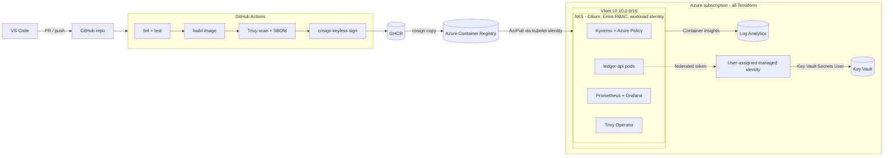

# aks-secure-platform-lab

A small, fake banking API (`ledger-api`) run on **Azure Kubernetes Service**,
built securely from the image up: a hardened container, the whole Azure
foundation in Terraform, a locked-down deployment with no passwords anywhere,
admission policies that reject unsafe workloads, metrics/logs/alerts, and a
vulnerability management loop. Built as a hands-on project to go deep on AKS,
container security, Terraform and Kubernetes platform engineering - every
piece is real, applied, and verified against a live cluster, not just written
and left untested.

**Full step-by-step guide with a screenshot for every command:
[docs/screenshots.md](docs/screenshots.md).**

## Architecture



## What's built

### 1. A hardened image, with numbers to prove it

`ledger-api` is built two ways from the same source, to show what hardening
actually buys you: "naive" (`FROM golang`, `go run`) vs. "hardened"
(multi-stage, distroless, pinned by digest, non-root).

| | naive | hardened |
|---|---|---|
| Size | 1.32 GB | 19.5 MB |
| CVEs, HIGH/CRITICAL | 183 (182 HIGH, 1 CRITICAL) | 0 |
| Runs as | root (UID 0) | 65532:65532 |
| Shell? | yes | no |

### 2. CI and supply chain

[](https://github.com/adam-bouafia/aks-platform-lab/actions/workflows/ci.yml)

Every PR into `main` runs lint/test, `tflint` + `trivy config` on the
infrastructure, a Trivy image scan that **fails the build on HIGH/CRITICAL**,
a CycloneDX SBOM, and (on `main` only) a push to GHCR tagged by commit SHA,
never `latest`. Every GitHub Action is pinned by full commit SHA. Branch
protection requires all of this to pass before any merge, including for the
repo admin. A break-it drill (reintroducing an unhardened base image in a PR)
confirmed the gate actually blocks a bad merge, not just logs a warning -
screenshots in [docs/screenshots.md](docs/screenshots.md#phase-2---ci-and-supply-chain).

### 3. The Azure foundation, in Terraform (`infra/`)

- Resource group, VNet, AKS subnet.
- AKS, **Azure CNI Overlay with the Cilium data plane** (overlay pod CIDR,
  native `NetworkPolicy` enforcement, no extra CNI add-on to install - see
  [ADR-001](docs/decisions/ADR-001-cni.md)).
- ACR, `admin_enabled = false` - pulls go through the kubelet's own managed
  identity only.
- Key Vault, RBAC-authorized, holding the app's API key.
- Log Analytics + Container Insights.
- A user-assigned identity federated to the AKS OIDC issuer, so the app's pod
  exchanges a Kubernetes token for an Entra token - no secret stored anywhere
  to make that exchange happen.
- Azure Policy (Audit) and the Key Vault Secrets Provider CSI driver, both
  enabled as AKS add-ons.

### 4. A deployment with every layer locked down (`deploy/`)

`ledger-api` runs under Pod Security Admission `restricted`: non-root,
read-only root filesystem, every capability dropped, no privilege escalation,
2 replicas spread across nodes with a PodDisruptionBudget.

**No password anywhere, verified live:**

```bash
curl -s -o /dev/null -w "%{http_code}\n" localhost:8080/api/v1/transactions   # 401
API_KEY=$(az keyvault secret show --vault-name <kv-name> --name api-key --query value -o tsv)
curl -H "X-API-Key: $API_KEY" localhost:8080/api/v1/transactions              # 200, real data
```

`NetworkPolicy`: default-deny ingress and egress, explicit allows only for DNS
and the app port from the right namespaces - confirmed by sending real traffic
from inside and outside the namespace, not just by reading the YAML.

Two break-it drills were run and logged: Pod Security Admission rejecting a
pod with no hardened `securityContext`, and the NetworkPolicy blocking a pod
outside the namespace. Both with screenshots.

### 5. Guardrails that actually reject bad workloads (`deploy/policies/`)

Kyverno, enforcing two policies and auditing a third:

- **Deny**: no `:latest` tags, every container must declare CPU/memory
  requests and limits. Both confirmed live - a real `kubectl run` with each
  violation was rejected with the policy's own error message.
- **Audit**: image-signature verification. Not enforced, because signing was
  never wired into CI (see "Known limitations" below) - see
  [ADR-003](docs/decisions/ADR-003-policy-engines.md) for why Azure Policy and
  Kyverno run side by side instead of just one.

### 6. Observability that shows real traffic (`deploy/observability/`)

`kube-prometheus-stack`, scraping `ledger-api` via a `ServiceMonitor`:

- A Grafana RED dashboard (rate, errors, duration) showing live data from
  real `curl` traffic, not a static mock.
- A `PrometheusRule`: fires on a 5xx ratio above 5%, or fewer than 2 ready
  replicas.
- Container Insights for logs, with three saved KQL queries
  ([docs/kql/](docs/kql/)) for errors, restarts, and node resource usage.

### 7. A vulnerability management loop that doesn't stop at build time

- A nightly GitHub Actions workflow rescans the deployed image and opens an
  issue on any new HIGH/CRITICAL finding - CVEs get published after you ship,
  so a clean scan at build time isn't enough.
- Trivy Operator runs in-cluster, continuously scanning every workload. Proven
  against the whole cluster: real CRITICAL/HIGH/MEDIUM findings surfaced on
  several AKS system components, screenshots in
  [docs/screenshots.md](docs/screenshots.md#phase-7---vulnerability-management-loop).

## Problems faced (the real engineering, not the happy path)

- **A fresh Azure subscription has no resource providers registered.** Each
  Azure service - Compute, AKS, VNets, ACR, Key Vault, Log Analytics, Azure
  Monitor - needs its own provider registered before the first resource of
  that type can be created, and it only shows up as an error the moment you
  try. Fixed by registering the full list up front.
- **A region or VM-size restriction can block a `terraform apply` outright.**
  Hit both a region-policy restriction and a quota wall on certain VM
  families; resolved by checking `az vm list-usage` and AKS's own
  subscription-specific allowed-SKU list (`az aks list-vm-skus`) before
  picking a size, not after.
- **An interrupted Terraform apply can leave AKS's own `provisioningState`
  stuck on `Failed`**, even once the underlying error is fixed - a later
  `terraform apply` that doesn't touch the same fields won't retry them.
  Fixed with a targeted `az aks disable-addons`/`enable-addons` cycle to force
  a fresh reconcile.
- **A single small node can't fit AKS's own system pods alongside a real
  workload.** `metrics-server`, Container Insights, the workload-identity
  webhook and Azure Policy/Gatekeeper alone consumed almost all of a 2-vCPU
  node's capacity before the app was even deployed. Fixed by scaling to 2
  nodes - cheap, and the actual lesson: budget for AKS's own overhead, not
  just the app, when sizing a cluster.
- **Prometheus silently dropped every scrape target for the app**, not even
  showing it as "down" - just absent. Root cause: a `ServiceMonitor`'s
  selector matches the **Service's own metadata labels**, not its
  `spec.selector` (which only controls routing) and not the Pod's labels. The
  Service had the right selector but no label of its own - one line fixed it,
  found by reading Prometheus's live relabeling rules from its own API rather
  than guessing.
- **Kyverno's admission-policy API changed underneath the plan.** Current
  Kyverno no longer executes the older `ClusterPolicy` type at all (not
  deprecated - removed), so every guardrail had to be rewritten against its
  new CEL-based policy types. A second, subtler bug followed: referencing an
  attestor by its name as a bare string in a CEL expression fails silently
  with a type error, not a validation failure - it needs the CEL `attestors`
  variable instead.
- **Neither Kyverno's signature check nor the in-cluster vulnerability
  scanner can read the app's own private registry.** The registry's admin
  account is deliberately disabled for least-privilege access, and the
  cluster's normal image-pull identity doesn't cover tools that need to
  inspect image/signature data directly, not just pull and run it. Documented
  as an open gap with the exact fix (a read-only, repository-scoped registry
  token) rather than quietly working around it.

Full detail - exact error messages, root causes, fixes - for every one of
these and more in [notes/failures.md](notes/failures.md).

## Known limitations (not hidden)

- Image signing (keyless `cosign` in CI) was never implemented, so Kyverno's
  signature check runs in Audit mode, not Enforce.
- The AKS cluster still allows local `kubectl` admin access rather than
  requiring Entra ID + Azure RBAC for every `kubectl` command.
- Kyverno and the in-cluster vulnerability scanner can't authenticate to the
  app's own private registry to inspect image/signature data (see above).

Full accounting, and what each one needs to be closed, in
[docs/security.md](docs/security.md).

## Repo map

- `app/` - the Go service, two Dockerfiles (naive and hardened).
- `infra/` - the whole Azure foundation, Terraform.
- `deploy/` - the Helm chart, Kyverno policies, observability values and
  manifests.
- `docs/` - architecture decision records, the security controls table, the
  runbook, saved KQL queries, and the full screenshot walkthrough.
- `notes/failures.md` - every real problem hit, in Symptom/Root cause/Fix
  format.
- `.github/workflows/` - CI and the nightly vulnerability rescan.

## Quickstart

Full commands for every step, in order, with a screenshot proving each result:
**[docs/screenshots.md](docs/screenshots.md)**. Operational commands
(zero-to-cluster, deploying every layer, troubleshooting, tear-down) without
the screenshots: **[docs/runbook.md](docs/runbook.md)**.
