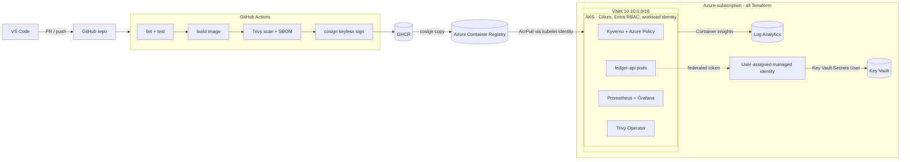

## aks-secure-platform-lab

This repository contains AKS lab materials.

The lab is designed to understand how to secure Azure Kubernetes Service (AKS) environment by implementing best practices and security features.

## Image hardening numbers

`ledger-api` is built two ways, from the same source code, to show what image hardening
actually buys you. "Naive" uses the full `golang` base image and runs with `go run`.
"Hardened" is a multi-stage build that ends on a `distroless` base, pinned by digest,
running as a non-root user.

| | naive | hardened |
|---|---|---|
| Size (`docker images`) | 1.32 GB | 19.5 MB |
| CVEs, HIGH/CRITICAL (`trivy image --severity HIGH,CRITICAL`) | 183 (182 HIGH, 1 CRITICAL) | 0 |
| Runs as (`docker inspect -f '{{.Config.User}}'`) | root (empty = UID 0 default) | 65532:65532 |
| Shell? (`docker run --rm --entrypoint sh `) | yes | no (`exec: "sh": executable file not found in $PATH`) |

Same application, same functionality. The only difference is how the image is built:
a multi-stage Dockerfile that throws away the Go compiler and ships only the compiled
binary, on top of a minimal base image with no shell and no package manager, running
as an unprivileged user.

## CI / supply chain

[](https://github.com/adam-bouafia/aks-platform-lab/actions/workflows/ci.yml)

Every pull request into `main` runs:

- **Lint & Test** - `go vet`, `go test -race`, `hadolint` on the Dockerfile
- **IaC Security & Lint** - `tflint` and `trivy config` against `infra/`
- **Build & Trivy Scan** - builds the hardened image, scans it with Trivy, fails the
  build on any HIGH/CRITICAL vulnerability, uploads results as SARIF to the repo's
  Security tab
- **Generate CycloneDX SBOM** - a software bill of materials for the exact image that
  was scanned, uploaded as a build artifact
- **Push to GHCR** - on `main` only, pushes the already-scanned image tagged by the
  git commit SHA (never `latest`)

All actions are pinned by full commit SHA, not by tag. Branch protection on `main`
requires every job above to pass, including for the repo admin, before a merge is
allowed. Dependabot checks weekly for updates to Go modules, GitHub Actions and the
Dockerfile's base image.

## Infrastructure (Terraform)

`infra/` holds the whole Azure foundation, applied from a local machine via `az login`
(no CI deployment - this account's tenant does not allow service principal
creation on a student/trial subscription, so Terraform never runs from GitHub
Actions here).

- Resource group, VNet (`10.10.0.0/16`), AKS subnet (`10.10.1.0/24`).
- AKS cluster `aks-ledger-lab`, 2 nodes (`Standard_D2as_v7`), **Azure CNI Overlay with
  the Cilium data plane** (pod CIDR `192.168.0.0/16`, service CIDR `10.100.0.0/16`,
  `NetworkPolicy` enforced natively - see `docs/decisions/ADR-001-cni.md`).
- ACR (`admin_enabled = false`, pull only via the kubelet's managed identity).
- Key Vault (RBAC-authorized, a `random_password` secret, no password anywhere in
  code, CI, or the image).
- Log Analytics workspace + Container Insights (`oms_agent` add-on).
- A user-assigned identity (`id-ledger-api`) federated to the AKS OIDC issuer, so
  the pod exchanges a Kubernetes token for an Entra token with no secret stored.
- `azure_policy_enabled = true` (Audit mode, the built-in restricted-standards
  initiative) and the Key Vault Secrets Provider CSI driver.

## Secure deployment (`deploy/`)

`ledger-api` runs in a dedicated `ledger` namespace under Pod Security Admission
`restricted`, deployed with Helm (`deploy/helm/ledger-api/`):

- 2 replicas, spread across nodes (`topologySpreadConstraints`), a
  `PodDisruptionBudget` (`minAvailable: 1`).
- Non-root, read-only root filesystem, every capability dropped, no privilege
  escalation.
- The API key is never in the image, a Kubernetes Secret, or CI - it is pulled live
  from Key Vault by the Secrets Store CSI driver, authenticated via the pod's
  workload identity:

  ```bash
  curl -s -o /dev/null -w "%{http_code}\n" localhost:8080/api/v1/transactions   # 401
  API_KEY=$(az keyvault secret show --vault-name <kv-name> --name api-key --query value -o tsv)
  curl -H "X-API-Key: $API_KEY" localhost:8080/api/v1/transactions              # 200, real data
  ```

- `NetworkPolicy`: default-deny ingress and egress, explicit allows only for DNS
  and the app port from the `ledger`/`monitoring` namespaces. Verified directly:
  a pod outside `ledger` times out reaching the service; even a pod *inside*
  `ledger` with no explicit allow rule is blocked on egress (stricter than most
  defaults - see `notes/failures.md`).

## Guardrails (`deploy/policies/`)

Kyverno (CEL-based `NamespacedValidatingPolicy`/`NamespacedImageValidatingPolicy` -
the project's original legacy-API draft no longer runs on current Kyverno, see
`notes/failures.md`), enforced and verified live against test pods:

- `disallow-latest-tag` - **Deny**, confirmed rejecting a PSA-compliant `:latest` pod.
- `require-requests-limits` - **Deny**, confirmed rejecting a pod with no
  resources block.
- `verify-image-signature` - **Audit**, not Deny: Phase 2b (cosign signing in CI)
  was never wired up, so enforcing would block the app's own unsigned image. See
  `docs/decisions/ADR-003-policy-engines.md` and `docs/security.md`.

## Observability (`deploy/observability/`)

`kube-prometheus-stack` (Prometheus + Grafana, small footprint: 6h retention, no
PVCs) scrapes `ledger-api`'s `/metrics` via a `ServiceMonitor`:

- A RED Grafana dashboard (`ledger-api-dashboard.json`) - request rate, 5xx ratio,
  p50/p95/p99 latency, ready replicas - confirmed showing live data from real
  `curl` traffic.
- A `PrometheusRule`: fires when the 5xx ratio is above 5% for 5 minutes, or ready
  replicas drop below 2. Both rules load with `health: ok`.
- Container Insights (Log Analytics) covers logs: three saved KQL queries in
  `docs/kql/` for errors, pod restarts, and node CPU/memory.

## Vulnerability management loop

- `.github/workflows/nightly-scan.yml` rescans the deployed image on GHCR every
  night and opens a GitHub issue on new HIGH/CRITICAL findings.
- Trivy Operator runs in-cluster, continuously scanning every workload - proven
  against the rest of the cluster (13 `VulnerabilityReports`, 12 real HIGH and 12
  MEDIUM findings on AKS system images) but **not** against `ledger-api` itself:
  the operator's scan jobs hit the same ACR-authentication gap as Kyverno's
  signature check (ACR admin is deliberately disabled). See `docs/security.md`'s
  "Known gaps" for the honest accounting and the fix.

## Honest gaps (not hidden)

- Image signing (Phase 2b, cosign) was never wired into CI.
- `local_account_disabled` is not set on the cluster (kept local `kubectl` access
  working rather than risk a lockout mid-session).
- Kyverno and Trivy Operator can't read our own ACR's image/signature data (the
  kubelet's `AcrPull` role covers normal pulls, but not these tools' own checks).

Full detail, root causes, and fixes for every one of these in `docs/security.md`
and `notes/failures.md`.

## Architecture


