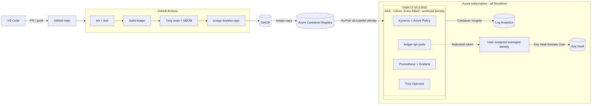

## aks-secure-platform-lab

This repository contains AKS lab materials.

The lab is designed to understand how to secure Azure Kubernetes Service (AKS) environment by implementing best practices and security features.

## Image hardening numbers

`ledger-api` is built two ways, from the same source code, to show what image hardening
actually buys you. "Naive" uses the full `golang` base image and runs with `go run`.
"Hardened" is a multi-stage build that ends on a `distroless` base, pinned by digest,
running as a non-root user.

| | naive | hardened |
|---|---|---|
| Size (`docker images`) | 1.32 GB | 19.5 MB |
| CVEs, HIGH/CRITICAL (`trivy image --severity HIGH,CRITICAL`) | 183 (182 HIGH, 1 CRITICAL) | 0 |
| Runs as (`docker inspect -f '{{.Config.User}}'`) | root (empty = UID 0 default) | 65532:65532 |
| Shell? (`docker run --rm --entrypoint sh `) | yes | no (`exec: "sh": executable file not found in $PATH`) |

Same application, same functionality. The only difference is how the image is built:
a multi-stage Dockerfile that throws away the Go compiler and ships only the compiled
binary, on top of a minimal base image with no shell and no package manager, running
as an unprivileged user.

## 3. Architecture (target)

