# Screenshots

Evidence for each phase, in order. Paths are relative to this file.

## Phase 2 - CI and supply chain

**Break-it drill:** a PR deliberately reintroducing an unhardened base image, blocked by the Trivy severity gate.

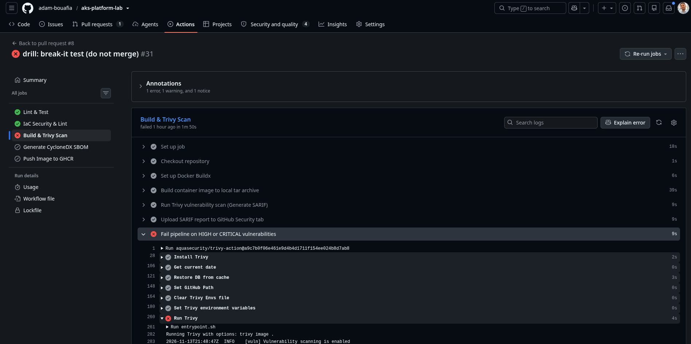
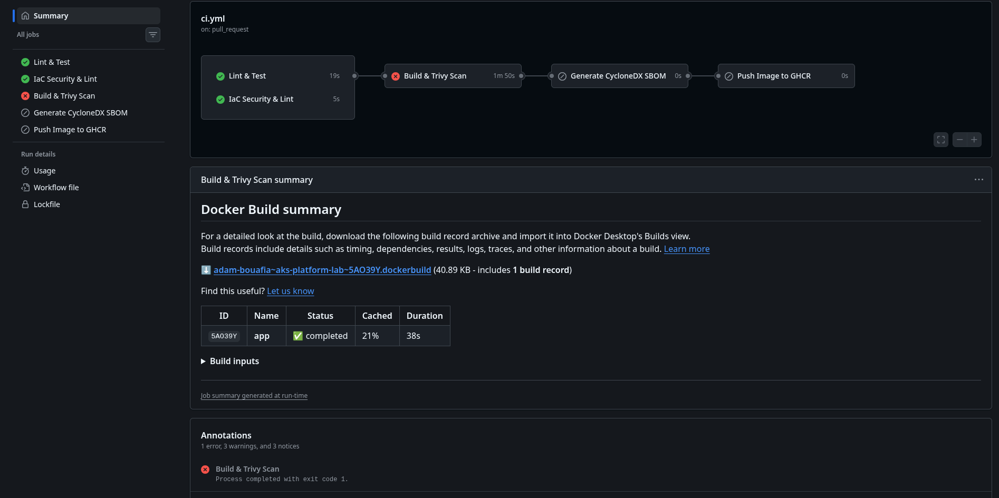
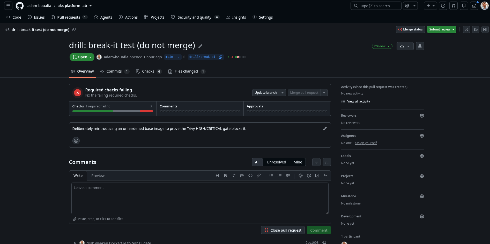

## Phase 3 - Terraform Azure foundation

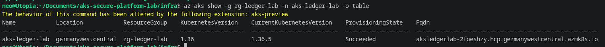
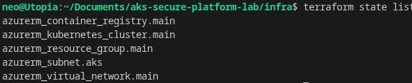
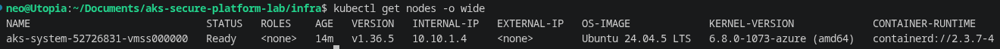
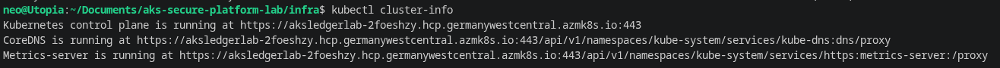
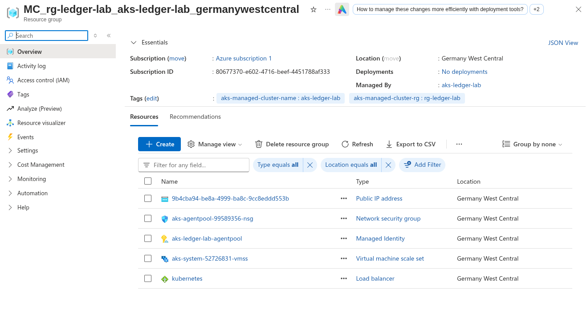
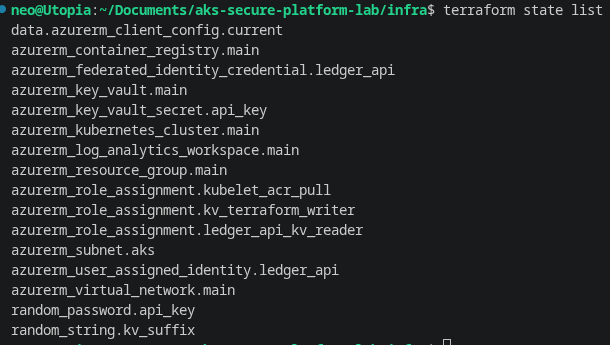
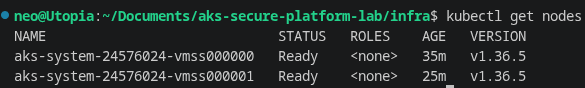

## Phase 4 - Secure deployment

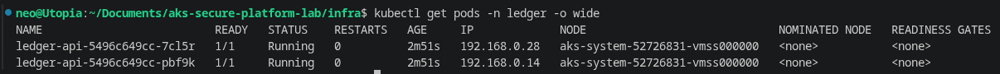
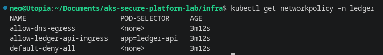
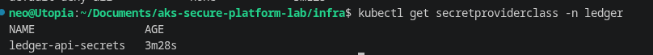
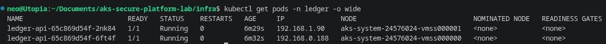

## Phase 5 - Guardrails

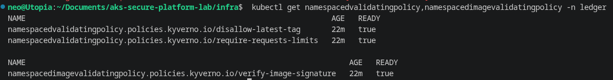

## Phase 6 - Observability

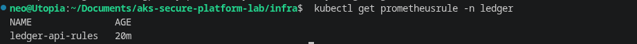
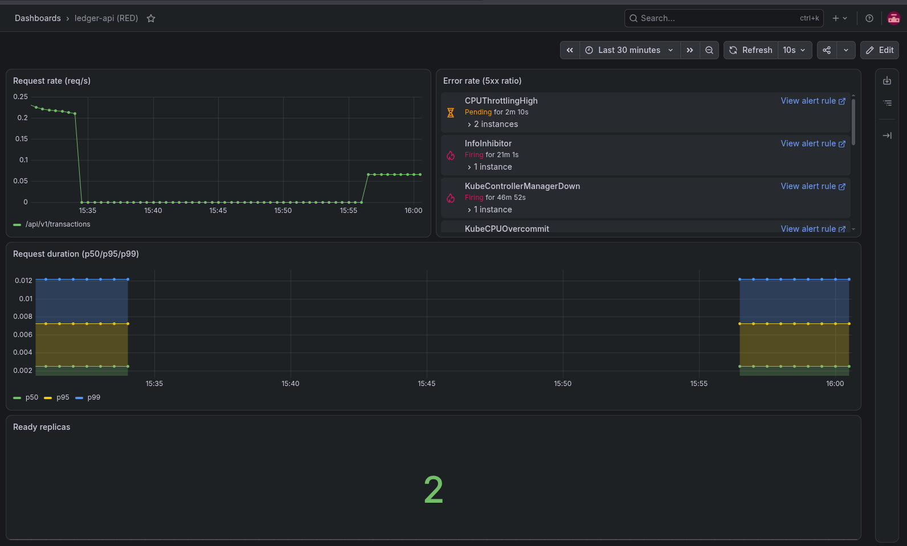
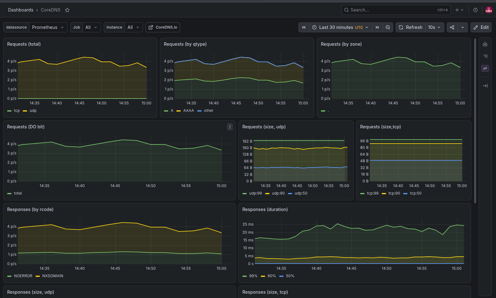
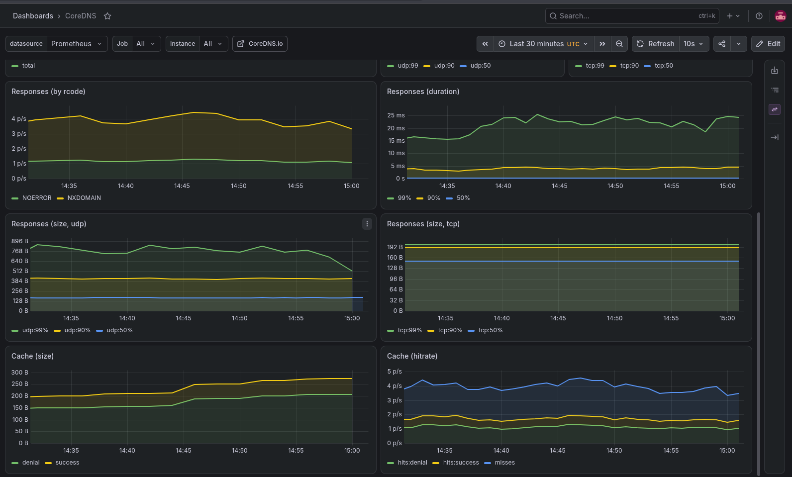
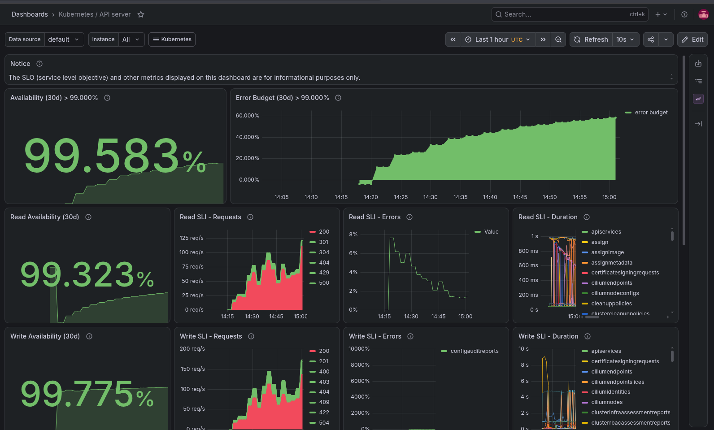
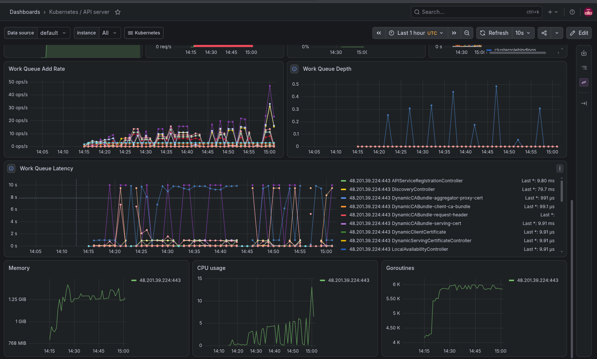
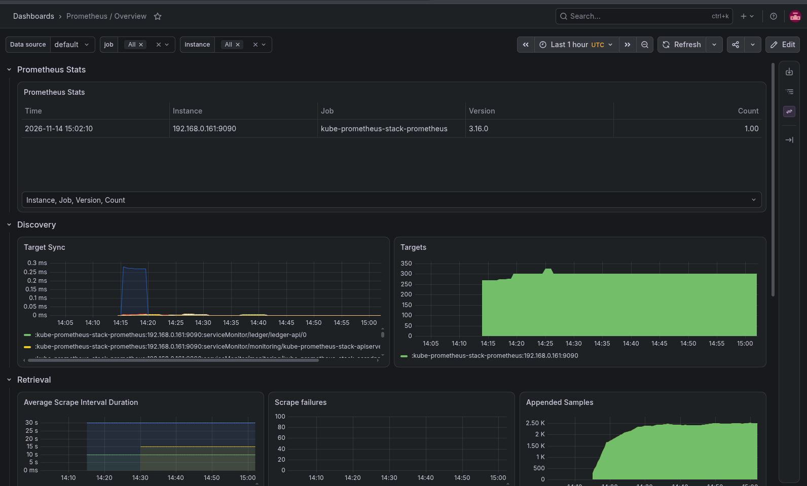
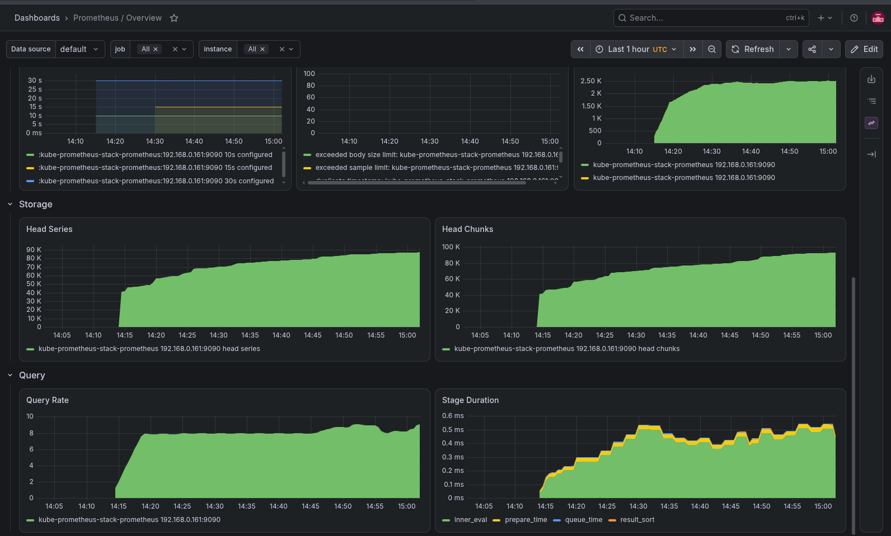
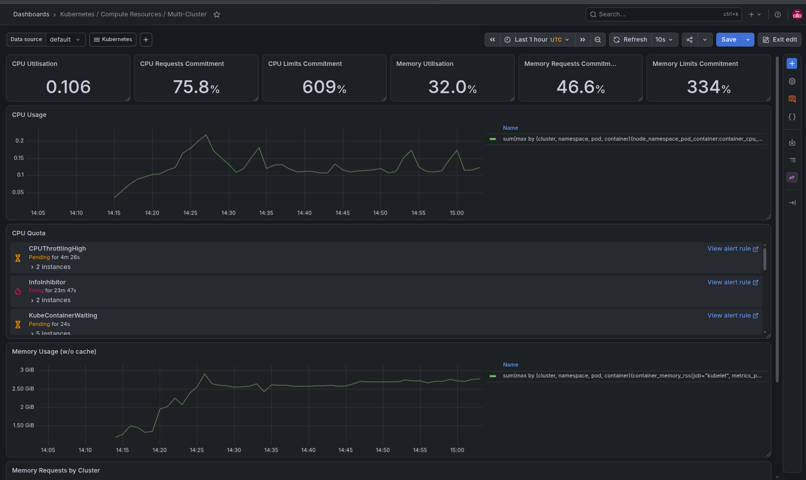
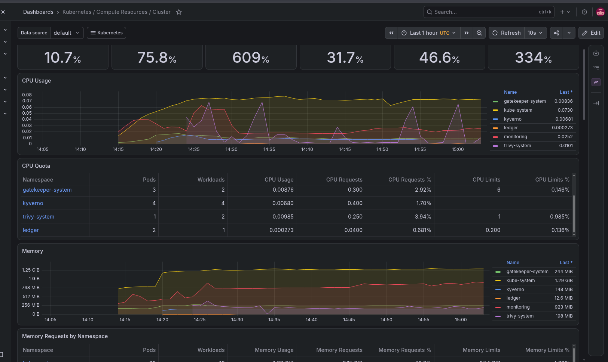
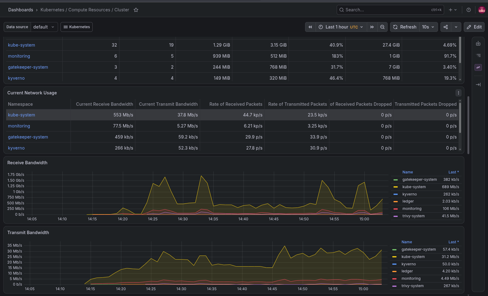

## Phase 7 - Vulnerability management loop

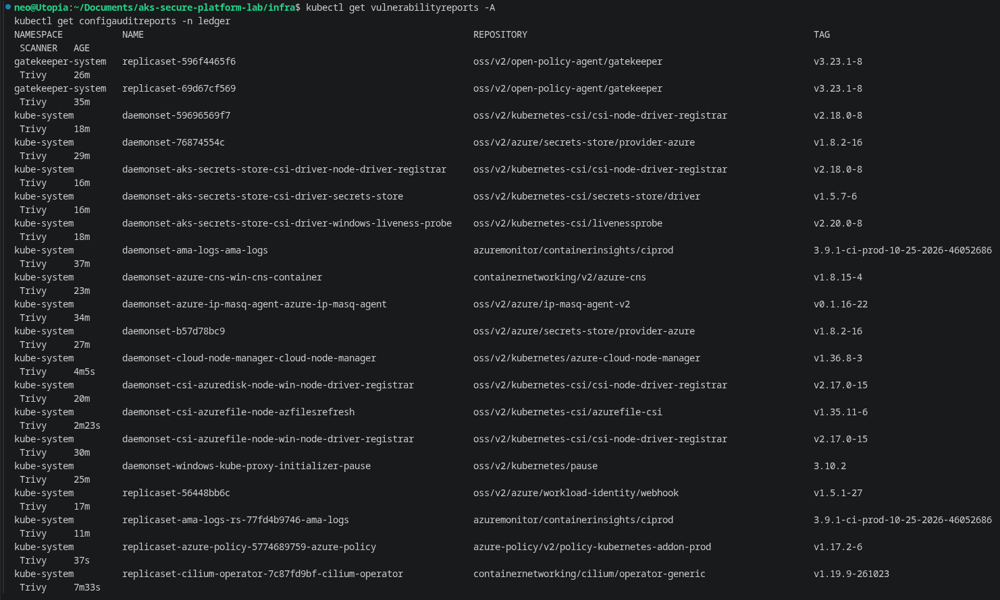
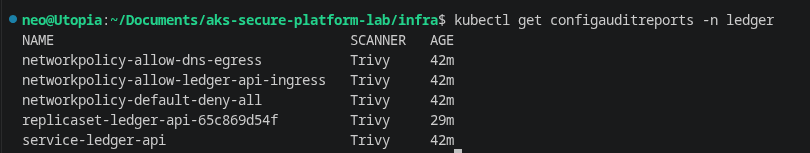
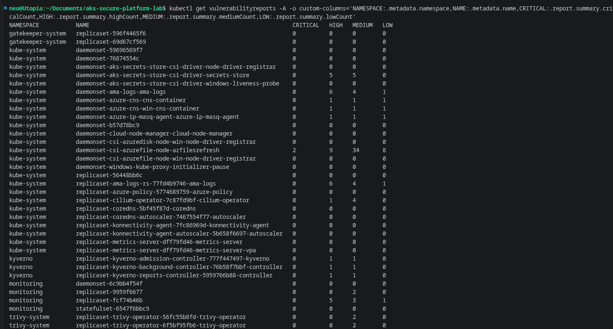

## Known gaps not covered by a screenshot

These were verified directly in the terminal during the session but not separately
captured as images (the cluster was torn down right after to stop billing):

- The `curl` sequence proving no password anywhere: `401` without the API key,
  `200` with the real key pulled live from Key Vault.
- The NetworkPolicy default-deny proof: a pod outside `ledger` timing out against
  the service.
- The Kyverno `kubectl apply` rejection messages for a `:latest`-tagged pod and a
  pod with no resource requests/limits.
- The Pod Security Admission `restricted` rejection message (break-it drill).

All of the above are quoted verbatim, with full command and output, in this
session's transcript and in `notes/failures.md`. They're straightforward to
re-capture on a future `terraform apply` if screenshots are needed later.
