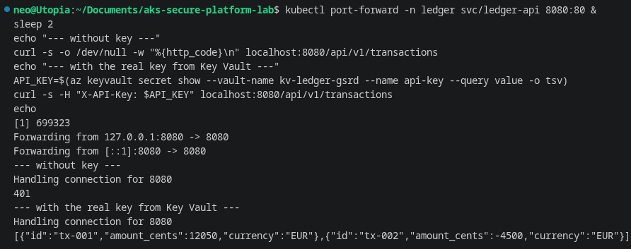
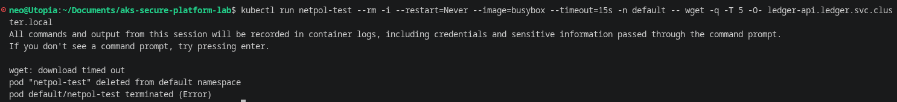
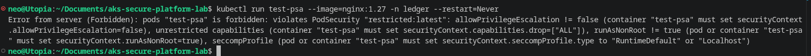
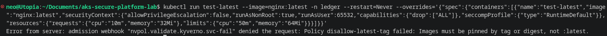
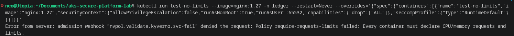

# Step-by-step walkthrough, with screenshots

Every phase of this lab, the exact command run, and the screenshot proving the
result. Paths are relative to this file. Run these yourself against a fresh
`terraform apply` to reproduce any of it.

## Phase 2 - CI and supply chain

**Break-it drill:** a PR deliberately reintroducing an unhardened base image, to
prove the Trivy severity gate actually blocks a bad merge, not just logs a
warning.

```bash
git checkout -b drill/break-ci
# edit app/Dockerfile: swap the distroless final stage for a full, unpinned base image
git commit -am "drill: weaken Dockerfile to test CI gate"
git push origin drill/break-ci
gh pr create --title "drill: break-it test (do not merge)" --base main
```


## Phase 3 - Terraform Azure foundation

```bash
cd infra
terraform init
terraform plan -out=tfplan
terraform apply "tfplan"
```


```bash
terraform state list
```


```bash
kubectl get nodes
```


```bash
kubectl cluster-info
```


Azure Portal, the AKS-managed resource group (`MC_<rg>_<cluster>_<region>`):


After adding Key Vault, Log Analytics and workload identity (see
`infra/keyvault.tf`, `infra/identity.tf`, `infra/monitoring.tf`) and re-applying:

```bash
terraform state list
```


A single node couldn't fit AKS's own system pods alongside the app and
observability stack (see `notes/failures.md`) - scaled `node_count` to 2:

```bash
kubectl get nodes
```


## Phase 4 - Secure deployment

```bash
kubectl apply -f deploy/namespace.yaml
helm upgrade --install ledger-api ./deploy/helm/ledger-api \
  --set workloadIdentityClientId=$(terraform -chdir=infra output -raw ledger_api_identity_client_id) \
  --set keyVaultName=$(terraform -chdir=infra output -raw key_vault_name) \
  --set tenantId=$(terraform -chdir=infra output -raw tenant_id)
kubectl get pods -n ledger -o wide
```


```bash
kubectl get networkpolicy -n ledger
```


```bash
kubectl get secretproviderclass -n ledger
```


After the node-count fix, both replicas spread across both nodes
(`topologySpreadConstraints`):

```bash
kubectl get pods -n ledger -o wide
```


**No password anywhere.** The API key lives only in Key Vault; the pod gets it
via workload identity, never a Kubernetes Secret, CI variable, or the image:

```bash
kubectl port-forward -n ledger svc/ledger-api 8080:80 &
sleep 2
echo "--- without key ---"
curl -s -o /dev/null -w "%{http_code}\n" localhost:8080/api/v1/transactions
echo "--- with the real key from Key Vault ---"
API_KEY=$(az keyvault secret show --vault-name <kv-name> --name api-key --query value -o tsv)
curl -s -H "X-API-Key: $API_KEY" localhost:8080/api/v1/transactions
```



**NetworkPolicy default-deny, verified live**, not just declared: a pod outside
the `ledger` namespace times out trying to reach the service.

```bash
kubectl run netpol-test --rm -i --restart=Never --image=busybox --timeout=15s -n default \
  -- wget -q -T 5 -O- ledger-api.ledger.svc.cluster.local
```



**Break-it drill:** Pod Security Admission `restricted` rejects a pod with no
hardened `securityContext` before it ever starts.

```bash
kubectl run test-psa --image=nginx:1.27 -n ledger --restart=Never
```



## Phase 5 - Guardrails

```bash
kubectl apply -f deploy/policies/
kubectl get namespacedvalidatingpolicy,namespacedimagevalidatingpolicy -n ledger
```


**Verified live, not just applied:** a `:latest`-tagged pod is rejected at
admission.

```bash
kubectl run test-latest --image=nginx:latest -n ledger --restart=Never \
  --overrides='{"spec":{"containers":[{"name":"test-latest","image":"nginx:latest",
  "securityContext":{"allowPrivilegeEscalation":false,"runAsNonRoot":true,"runAsUser":65532,
  "capabilities":{"drop":["ALL"]},"seccompProfile":{"type":"RuntimeDefault"}},
  "resources":{"requests":{"cpu":"10m","memory":"32Mi"},"limits":{"cpu":"50m","memory":"64Mi"}}}]}}'
```



A pod with no resource requests/limits is rejected too:

```bash
kubectl run test-no-limits --image=nginx:1.27 -n ledger --restart=Never \
  --overrides='{"spec":{"containers":[{"name":"test-no-limits","image":"nginx:1.27",
  "securityContext":{"allowPrivilegeEscalation":false,"runAsNonRoot":true,"runAsUser":65532,
  "capabilities":{"drop":["ALL"]},"seccompProfile":{"type":"RuntimeDefault"}}}]}}'
```



`verify-image-signature` runs in **Audit**, not Deny - Phase 2b (cosign signing)
was never wired into CI, so enforcing it would block the app's own unsigned
image. See `docs/decisions/ADR-003-policy-engines.md`.

## Phase 6 - Observability

```bash
helm upgrade --install kube-prometheus-stack prometheus-community/kube-prometheus-stack \
  -n monitoring --create-namespace -f deploy/observability/kube-prometheus-stack-values.yaml
kubectl apply -f deploy/observability/prometheusrule.yaml
kubectl get prometheusrule -n ledger
```


Import the dashboard, then open it in Grafana (port-forward
`kube-prometheus-stack-grafana` to a local port, log in `admin`/`admin`):


The rest of `kube-prometheus-stack`'s bundled dashboards work too, proving the
whole stack - not just the one app - is observable:


## Phase 7 - Vulnerability management loop

```bash
helm upgrade --install trivy-operator aqua/trivy-operator \
  -n trivy-system --create-namespace -f deploy/observability/trivy-operator-values.yaml
kubectl get vulnerabilityreports -A
kubectl get configauditreports -n ledger
```


```bash
kubectl get vulnerabilityreports -A -o custom-columns='NAMESPACE:.metadata.namespace,NAME:.metadata.name,CRITICAL:.report.summary.criticalCount,HIGH:.report.summary.highCount,MEDIUM:.report.summary.mediumCount,LOW:.report.summary.lowCount'
```


Trivy Operator's `ledger-api` image scan itself hit an ACR-authentication gap
(same root cause as Kyverno's signature check above) - documented, not hidden,
in `docs/security.md`'s "Known gaps" section.

## Tear down

```bash
cd infra
terraform plan -destroy -out=tfdestroy
terraform apply "tfdestroy"
az resource list -g rg-ledger-lab -o table   # confirm empty
```
